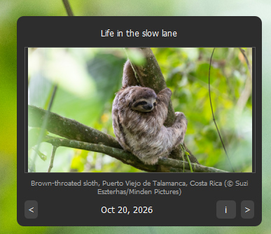

# Bing Wallpaper Clone

A tiny Windows tray app that sets your desktop wallpaper to Bing's daily image, without Microsoft's bundled software. Built with Python and PyQt5.



## Features

- Sets the latest Bing image of the day as your wallpaper
- Browse the last 8 days from a small popup at the tray icon, and apply any of them with one click
- Downloads the 4K (UHD) version, with automatic fallback to 1080p
- Never overwrites a wallpaper you picked manually; it only changes the desktop when a new daily image arrives
- Works offline using cached metadata and previously downloaded images
- Optional "Run at startup" toggle in the tray menu
- Automatic cleanup of old wallpapers (keeps the newest N, never touches other files in the folder)
- Single instance: launching it twice won't add a second tray icon

## Requirements

- Windows 10 or 11 (wallpaper and startup features use the Windows API)
- Python 3.9+ (only if running from source)

## Run from source

```bash
pip install -r requirements.txt
python bing_clone.py
```

## Build the exe

```bash
pip install -r requirements-dev.txt
pyinstaller bing_clone.spec
```

The result is `dist/bing_clone.exe`. You can move it anywhere and use **Run at startup** from the tray menu.

If your antivirus flags the one-file build, build a folder version instead, which also starts faster:

```bash
pyinstaller --noconsole --onedir --icon=icon.ico --add-data "icon.ico;." bing_clone.py
```

## Usage

- **Left-click** the tray icon to open or close the preview popup.
- **< / >** go to older or newer wallpapers; the choice is applied immediately.
- **i** opens the image's page on Bing.
- **Right-click** the tray icon for *Update Now*, *Open wallpaper folder*, *Run at startup* and *Exit*.

## Settings

On first run the app creates `%LOCALAPPDATA%\BingWallpaperClone\settings.json`. Restart the app after editing it.

| Key | Default | Description |
| --- | --- | --- |
| `market` | `en-US` | Bing region, e.g. `de-DE`, `ja-JP`, `fr-FR`. Each region has different images. |
| `check_interval_minutes` | `120` | How often to check for a new image (minimum 15). |
| `uhd` | `true` | Try the 3840x2160 version first. |
| `keep_last` | `30` | Number of wallpapers to keep. `0` disables cleanup. |
| `save_dir` | `~/Pictures/BingWallpapers` | Where images are saved. |

## Troubleshooting

Logs are written to `%LOCALAPPDATA%\BingWallpaperClone\app.log`. Check there first if nothing happens.

## Notes

This project is not affiliated with or endorsed by Microsoft. Bing wallpapers are copyrighted by their photographers and Microsoft; this tool is intended for personal use. Please don't redistribute the downloaded images.
